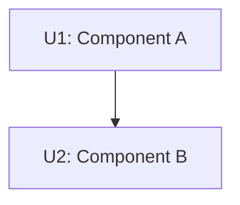

# Writing Plans

Turn an approved design into a minimal, self-sufficient, verifiable plan. This skill is the single source of truth for plan format: planners write to it, reviewers check against it, `executing-plans` runs it.

A plan is the set of decisions the executor cannot make alone: which files, which names and signatures, which spec values, which tests prove each unit. It is not the code. The executor writes idiomatic code once the interface and the test are exact.

Design approval (from `brainstorming`) permits only this skill. Plan approval, obtained here, permits `executing-plans`.

## Principles

1. **Think before planning.** The approved design (Goal, Constraints, Success criteria, Assumptions) is the input. Carry its assumptions into the plan; do not re-decide the design. If the design has a gap or contradiction, stop and return to `brainstorming` instead of guessing. If a step has several readings, present them.
2. **Simplicity first.** Plan the fewest units and steps that meet the success criteria. No unrequested features, single-use abstractions, or speculative configurability. If the plan could be half as long, rewrite it.
3. **Surgical scope.** List only files the work requires and follow existing conventions. Record unrelated problems under `Risks` as notes, never as steps. Every `AffectedFiles` entry and step must trace to the Goal or an Acceptance item.
4. **Goal-driven.** Every Acceptance item is observable and covered by a `Verify` command with an expected result. Write tests first wherever behavior is testable.
5. **Executor-proof.** Assume the executor has no chat history, sees only its own unit, and will not rediscover scope. If a decision is not in the plan, the executor must stop and ask, so leave none open.
6. **Decide, don't transcribe.** A step is done when the executor can write exactly one reasonable thing from it, no more. A line that decides nothing is a gap; a body the signature and tests already determine is a transcript. Both are defects.

## Workflow

1. Read the approved design; read code only to fill gaps. Confirm the design block has Goal, Success criteria, Assumptions, and a Baseline. If any is missing, return to `brainstorming`.
2. Map files first: decide which files are created or modified and the one responsibility of each. Follow existing patterns; split a file only if it is already unwieldy. Anchor every existing-code reference with a symbol name and a line range.
3. Fix exact signatures and types, then group work into TaskUnits per the partitioning rules and draw the diagram.
4. Write `Review Focus` (see below), then pin each item to a test step in the owning unit.
5. Run the self-review checklist and fix issues inline.
6. Present for approval in the calling agent's checkpoint format (default: AffectedFiles table, one line per unit, 3-6 key changes). Nothing is saved yet.
7. Save the approved plan with `Status: APPROVED` and hand off to `executing-plans`.

## Hard gate

- Write no code during planning. The only file ever written is the plan, and only after approval.
- Wait for explicit approval before saving and before any execution.
- No placeholders (`TODO`, `TBD`, "handle edge cases", "add validation later", "write tests for the above", or a type or function no unit defines). Every step carries explicit logic or commands.
- Every plan embeds a valid Mermaid diagram.
- Resolve `Open Questions` with the user before approval. A saved plan states `None`.
- Be self-sufficient: use exact repo-relative paths, symbol names, and line ranges.
- Never put secrets, tokens, or real credentials in the plan; reference env var names instead.
- Never overwrite an existing plan file. If the path exists, ask whether this is a revision (new `-fix<N>` or suffixed name) or a replacement.
- After approval the plan is frozen. Only `executing-plans` may tick checkboxes or append a `Deviation Log`; any other change goes back through approval.

## Partitioning

- A unit is the smallest piece that carries its own test cycle and that a reviewer could reject while approving its neighbor. Fold setup, config, scaffolding, and docs into the unit whose deliverable needs them. Each unit ends with an independently testable deliverable.
- At most 5 TaskUnits; a small change may be one. If the work needs more than 5 units or about 15 files, split it into sequential plans, each with its own approval.
- Unit `Files` sets are disjoint, and every `AffectedFiles` entry belongs to exactly one unit.
- `DependsOn` is `none` or unit IDs, acyclic, used only for real ordering. Prefer units that can run in parallel, but never split a unit just to create parallelism.
- Cross-unit signatures are declared once, in the producing unit's `Produces`; consuming units copy the exact signature into `Consumes`. The producing unit runs first.
- Every unit has a non-empty `Spec` and `Verify`; every file in `Files` appears in at least one step.
- No step touches a file outside its unit's `Files`.

## Step granularity

- 2-5 minutes each, one action with a checkable result.
- Name the exact file path, method signature with parameter and return types, and the specific values the spec pins.
- By step kind:
  - **Test step:** test name, inputs, and assertions as code, with the spec's exact values.
  - **Code step:** file, exact signature, and the logic only where signature and tests leave a choice (one line: library call or data structure). Precise prose or pseudocode (max ~15 lines) only for an algorithm they do not determine, or for exact copy the spec fixes. Full implementations are the executor's job.
  - **Verification step:** the command and the output that means it passed.
  - **Cross-unit reference:** point to the producing unit's `Produces`; do not repeat its code.
- Test-first: failing test, run to see it fail, minimal logic, run to see it pass.
- **No-test exception:** for non-behavioral changes (config, docs, rename, move, generated files, migration scripts) mark the step `(no-test: reason)` and give a verification command instead of a failing test. Behavioral code never gets this exception.
- Irreversible or data-touching steps (migration, delete, config in shared environments) include a rollback command or state `irreversible` under `User Review Required`.

## Verify rules

- `Verify` lists exact commands with expected results, in the form `command -> expected`.
- Commands are non-interactive and deterministic: exit code or a matched output line, never "looks correct".
- A unit's `Verify` must pass when only its `DependsOn` units are done.
- The final unit or `Acceptance` includes the full regression command from the design's Baseline, expected to match the baseline result except for intended changes.
- Runtime behavior (HTTP endpoint, CLI, job) is verified by running it, not only by unit tests, whenever an Acceptance item describes runtime behavior.

## Review Focus

The spec says what the software must do, not everything it will meet; its silence on an input is not permission for that input to break. List up to 5 input classes or failure modes the design implies but no Acceptance item covers, most likely to bite first (empty or null input, duplicates, boundary values, concurrent calls, partial failure, malformed data). Each line names the input or condition and the behavior a reasonable person expects. Then pin each one to a test step in the unit that owns the code, tagged `(RF<n>)`. An empty section means you checked and found none.

## Locations

- Plan: `local/agents/plans/YYYY-MM-DD-<feature-name>.md` (kebab-case)
- Fix plan (from a work review): `local/agents/plans/YYYY-MM-DD-<feature-name>-fix<N>.md`, containing only files that need changes
- Create the directory if missing. Use repo-relative paths inside the plan.

## Template

The builder parses `Goal`, `AffectedFiles`, `TaskUnits`, `Spec`, `Verify`, `Acceptance`, and the unit fields `Files` and `DependsOn`. Never rename or omit them. Bracketed text is filled per the "How to fill" table below.

````markdown
# [Feature Name] Implementation Plan

**Status:** APPROVED (YYYY-MM-DD)
**Design:** [repo-relative path to the approved design/spec, or "inline in chat"]

## Goal
[One sentence]

## Out of Scope
- [Non-goals from the design, or "None"]

## Architecture
[Approved approach in 2-4 lines]



## Assumptions
- [Carried from the approved design, marked as assumptions]

## Prerequisites
- Branch / dependencies / environment: [what must already be true]
- Baseline: `command` -> [result before any change, including known pre-existing failures]

## User Review Required
> [!IMPORTANT]
> [Breaking changes, irreversible steps, key decisions, risks needing approval, or "None"]

## Open Questions
None

## AffectedFiles
| File | Action | Why |
| :--- | :--- | :--- |
| `path/to/file` | NEW / MODIFY / DELETE | [reason tied to Goal or Acceptance] |

## Constraints
- [Project-wide limits copied verbatim from the design: version floors, dependency limits, naming/copy rules, platform. Apply to every unit.]
- Convention: [existing pattern to follow] (ref: `path/to/example`)

## Review Focus
- RF1: [input or condition] -> [expected behavior] (pinned in U<n>)

## TaskUnits

### U1: [Component Name]
- **Files:** `path/to/file`, `path/to/other`
- **DependsOn:** none
- **Consumes:** none | [exact signatures from earlier units, e.g. `U1: UserRepo.findById(String id): Optional<User>`]
- **Produces:** none | [exact signatures later units rely on]
- **Spec:**
  - [ ] **Step 1:** `path/to/file` (`symbol`, L10-40) - write failing test `name`: input -> expected (one extra test per pinned `(RF<n>)`)
  - [ ] **Step 2:** run `command` -> FAIL with [expected message]
  - [ ] **Step 3:** `path/to/file` - implement `Type method(ParamType p)`: [logic only if not determined by signature + test]
  - [ ] **Step 4:** run `command` -> PASS
- **Verify:** `command` -> [expected result]

## Acceptance
- [ ] AC1: [Observable, checkable criterion] (verified by U1)
- [ ] ACn: full regression `baseline command` -> matches Baseline except intended changes (verified by U<last>)

## Risks
- [Risk and mitigation; unrelated issues noticed, as notes only]
````

## How to fill

| Section | Write | Avoid |
| :--- | :--- | :--- |
| Goal | One sentence, the outcome, no how | Lists, implementation detail |
| Out of Scope | Design's non-goals, one line each | New scope not in the design |
| Architecture | Chosen approach and why in 2-4 lines; diagram nodes match unit IDs | Re-debating rejected options |
| Assumptions | Design assumptions verbatim | Your own new guesses (ask instead) |
| Baseline | Real command run on the untouched tree, with its actual result | "tests pass" without a command |
| AffectedFiles | One row per file, `Why` cites Goal or an AC | Files "just in case" |
| Constraints | Exact values from the design (versions, limits, names); conventions as `Convention:` lines with a reference file path | Paraphrase, generic best practice, style opinions the repo does not follow |
| Review Focus | Concrete input + expected behavior, ranked | Vague "handle errors"; items already in Acceptance |
| Unit Spec | Steps per "Step granularity" | Full function bodies, steps that decide nothing |
| Consumes / Produces | Exact name, params, return type | Prose descriptions of interfaces |
| Verify | `command -> expected` runnable as-is | Manual inspection |
| Acceptance | Observable behavior, each mapped to a unit | Restating steps |
| Risks | Real risk plus mitigation; noticed-but-unrelated issues | Turning them into steps |

## Self-review

1. **Spec coverage:** every design requirement and success criterion maps to a unit and an Acceptance item; list gaps and add units.
2. **Step scan:** no placeholders or ambiguous wording; every step lets the executor write exactly one reasonable thing; no step carries a body the signature and tests already determine.
3. **Partitioning:** files disjoint, `DependsOn` acyclic, at most 5 units, no step leaves its unit's `Files`.
4. **Traceability:** every `AffectedFiles` entry has a step and traces to the Goal or an Acceptance item; nothing exceeds the design's success criteria.
5. **Type consistency:** names, signatures, and types in every `Consumes` match the producing unit's `Produces` exactly (`clearLayers()` in U2 vs `clearFullLayers()` in U4 is a bug).
6. **Review Focus:** each RF item has a pinned test step in its owning unit; the list has at most 5 items.
7. **Verification:** every Acceptance item names its verifying unit and is covered by a `Verify`; every `Verify` is runnable `command -> expected`; the regression command is present; every behavioral step is test-first; every `no-test` step states its reason.
8. **Anchors:** symbols and line ranges exist in the current code.
9. **Diagram and header:** diagram is valid and matches the units; `Prerequisites` has a Baseline; `Open Questions` is `None`.
10. **Proportion:** if the plan is several times longer than the design, or code blocks dominate it, replace bodies with signatures, test names, and assertions, then re-check that each step is still unambiguous.

## Decision rules

| Condition | Action |
| :--- | :--- |
| Self-review finds ambiguity, placeholders, or a transcript-style step | Fix inline before presenting |
| `Open Questions` not empty | Ask the user, merge answers, continue |
| Design gap or contradiction found | Stop, return to `brainstorming` |
| More than 5 units or about 15 files | Split into sequential plans |
| Independent review returns `CHANGES_REQUIRED` | Fix the draft, re-review; after 3 rounds, escalate to the user |
| Plan file already exists | Never overwrite; ask revision vs replacement |
| User approves | Save with `Status: APPROVED`, reply with the path, hand off to `executing-plans` |
| User requests changes | Update the draft, request approval again |