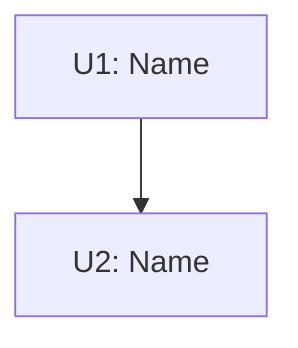

The builder parses `Goal`, `AffectedFiles`, `TaskUnits`, `Spec`, `Verify`, `Acceptance`, and the unit fields `Files` and `DependsOn`. Never rename or omit them.

```
# [Feature Name] Plan

**Status:** APPROVED (YYYY-MM-DD) | **Design:** [path or "inline in chat"]

## Goal
[One sentence: the outcome.]

## Out of Scope
- [Non-goals from the design, or "None"]

## Flow


## Assumptions & Baseline
- [Assumptions carried from the design]
- Baseline: `command` -> [result before any change, incl. known failures]

## Needs Your Attention
- [Max 3: breaking change, irreversible step, or decision to double-check. Or "None"]

## Open Questions
None

## AffectedFiles
| File | Action | Why |
| :--- | :--- | :--- |
| `path/to/file` | NEW / MODIFY / DELETE | [one short reason tied to Goal or AC] |

## Rules
- [Max 5 one-liners: version floors, no new deps, naming/copy rules]
- Convention: [pattern to follow] (ref: `path/to/example`)

## Review Focus
- RF1: [input] -> [expected] (U<n>)

## TaskUnits

### U1: [Name] - [one-line purpose]
- **Files:** `path/a`, `path/b`
- **DependsOn:** none
- **Consumes:** none
- **Produces:** none | `Type Class.method(ParamType p)`
- **Spec:**
  - [ ] **Step 1:** [file/symbol] - [what changes, one sentence]
  - [ ] **Step 2:** [file/symbol] - test `name`: [input -> expected]
- **Verify:** `command` -> [expected]

## Acceptance
- [ ] AC1: [observable criterion] (verified by U1)
- [ ] ACn: full regression `baseline command` -> matches Baseline except intended changes (verified by U<last>)

## Risks
- [Real risk + mitigation; unrelated issues noticed, as notes only]
```