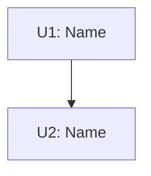

The builder parses `Goal`, `AffectedFiles`, `TaskUnits`, `Spec`, `Tests`, `Verify`, `Acceptance`, `Done`, and the unit fields `Files`, `DependsOn`, `Consumes`, `Produces`. Never rename or omit them.
`Spec` holds decisions only. Never put code in any field.

# [Feature Name] Plan

**Status:** APPROVED (YYYY-MM-DD) | **Design:** [path or "inline in chat"]

## Goal

[One sentence: the outcome.]

## Out of Scope

- [Non-goals from the design, or "None"]

## Flow

## Assumptions & Baseline

- [Assumptions carried from the design]
- Baseline: `command` -> [result before any change, including known failures]

## Needs Your Attention

- [Max 3 one-liners: breaking change, irreversible step, or decision to double-check. Or "None"]

## Open Questions

None

## AffectedFiles

| File           | Action                | Unit | Why                                   |
| :------------- | :-------------------- | :--- | :------------------------------------ |
| `path/to/file` | NEW / MODIFY / DELETE | U1   | [one short reason tied to Goal or AC] |

## Rules

- [Max 5 one-liners: version floors, no new deps, naming or copy rules]

## Review Focus

- RF1: [input] -> [expected] (U<n>)

## TaskUnits

### U1: [Name] - [one-line purpose]

- **Files:** `path/a`, `path/b`
- **DependsOn:** none
- **Consumes:** none
- **Produces:** none | `Type Class.method(ParamType p)`
- **Spec:** (decisions only, 2-5 bullets)
  - [Name / business value / public behavior the design fixed]
- **Tests:** (test-first, max 5)
  - `testName`: [input] -> [expected] (RF1)
- **Verify:** `command` -> [expected]
- [ ] **Done**

## Acceptance

- [ ] AC1: [observable criterion] (verified by U1)
- [ ] ACn: full regression `baseline command` -> matches Baseline except intended changes (verified by U<last>)

## Risks

- [Real risk and mitigation. Unrelated issues noticed, as notes only.]
